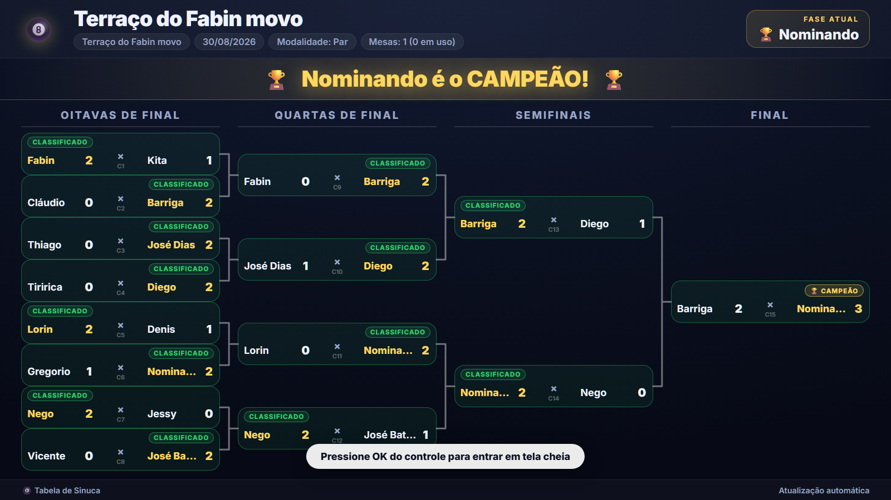
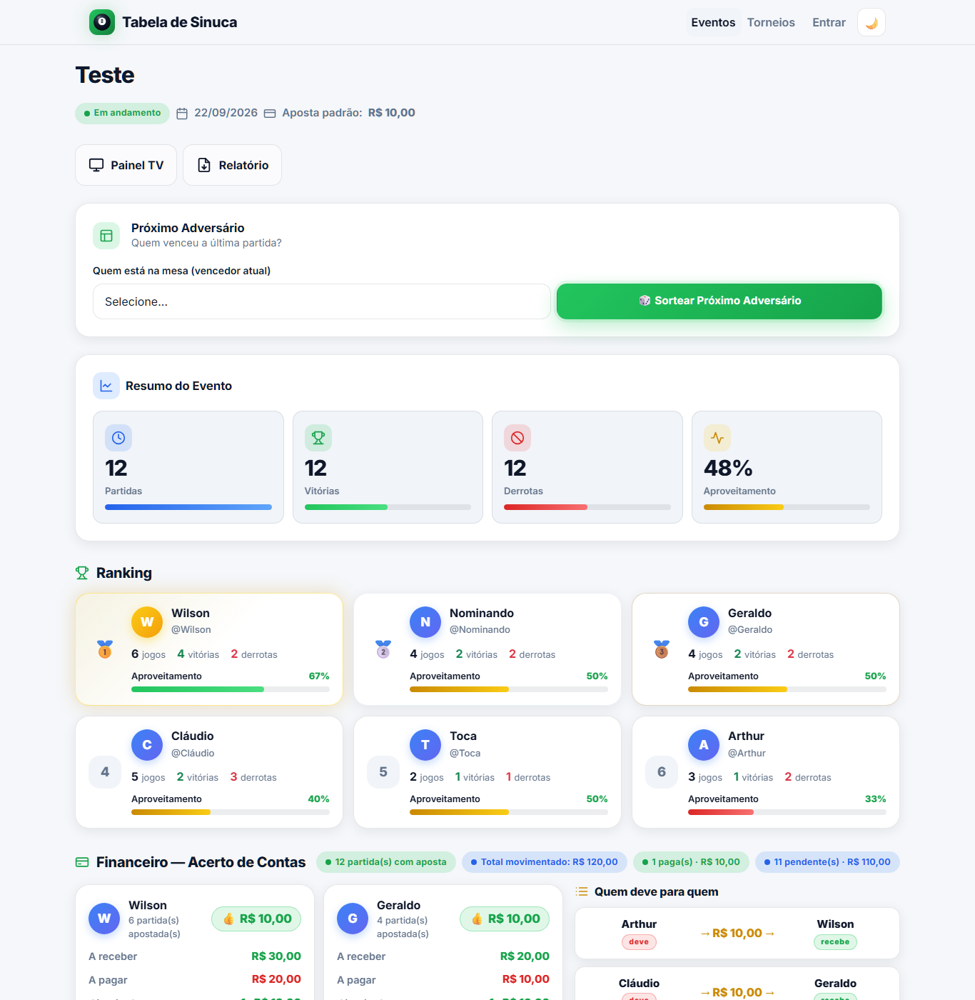
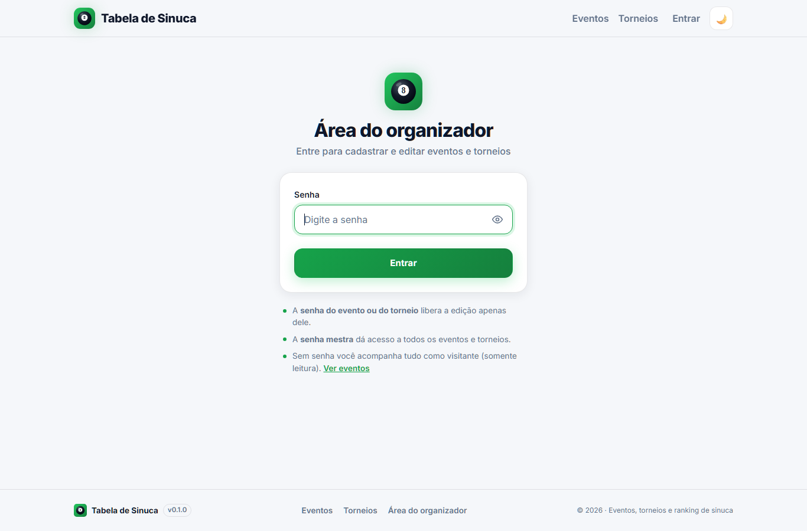

<p align="center">
  
</p>

<h1 align="center">Tabela de Sinuca</h1>

<p align="center">
  Sistema web para organizar <strong>eventos</strong> e <strong>torneios de sinuca</strong>:
  jogadores, partidas, chaveamento mata-mata, ranking, acerto de apostas e painel ao vivo para TV.
</p>

<p align="center">
  <a href="https://github.com/guruwlsnetflix-collab/tabela-sinuca/actions/workflows/ci.yml"></a>
  = 20">
  
</p>

<p align="center">
  
</p>

## Funcionalidades

### Eventos (rodadas "rei da mesa")

- Cadastro de eventos com período, status e valor de aposta padrão.
- Jogadores por evento, com campanha individual e opção de desistência.
- Registro de partidas com edição, exclusão e marcação de pagamento.
- **Sorteio do próximo adversário**: o vencedor permanece na mesa.
- **Ranking automático** (vitórias → derrotas → ordem de cadastro) com aproveitamento.
- **Financeiro**: quanto cada jogador tem a receber/pagar e "quem deve para quem".
- **Relatório** pronto para impressão ou exportação em PDF.

### Torneios (mata-mata)

- Chave fixa de 16 jogadores: oitavas, quartas e semifinais em melhor de 3, final em melhor de 5.
- Sorteio da chave, avanço automático do vencedor e opção de desfazer a última partida.
- Limite de jogos simultâneos conforme o número de mesas.
- API JSON pública (`/api/torneios`) para placares e integrações.

Detalhes das regras em [docs/TORNEIOS.md](docs/TORNEIOS.md).

### Painel ao vivo

- Páginas `/painel-tv` de eventos e torneios pensadas para telão, Smart TV e Fire Stick.
- Atualização automática sem recarregar a página e modo tela cheia pelo controle remoto.

### Acesso

| Perfil                 | Como entra                  | O que pode fazer                   |
| ---------------------- | --------------------------- | ---------------------------------- |
| Visitante              | Sem senha                   | Acompanhar tudo (somente leitura)  |
| Organizador do evento  | Senha definida no evento    | Editar aquele evento               |
| Organizador do torneio | Senha definida no torneio   | Editar aquele torneio              |
| Administrador          | `SENHA_MAESTRA` do servidor | Editar todos os eventos e torneios |

<p align="center">
  
  
</p>

## Como executar

Requer **Node.js 20+** (a versão usada no CI está em [.nvmrc](.nvmrc)).

```bash
npm install
cp .env.example .env   # defina SENHA_MAESTRA
npm run db:init        # cria o banco e as tabelas
npm run dev            # http://localhost:3000
```

Para abrir o painel numa TV da mesma rede, acesse `http://<ip-do-computador>:3000` no navegador da TV.

### Variáveis de ambiente

| Variável               | Padrão              | Descrição                                                             |
| ---------------------- | ------------------- | --------------------------------------------------------------------- |
| `PORT`                 | `3000`              | Porta HTTP                                                            |
| `HOST`                 | `0.0.0.0`           | Interface de rede                                                     |
| `DATABASE_PATH`        | `./data/sinuca.db`  | Arquivo SQLite                                                        |
| `SENHA_MAESTRA`        | _gerada ao iniciar_ | Senha de administrador. Se vazia, uma senha temporária vai para o log |
| `SESSION_SECRET`       | _derivado_          | Segredo que assina o cookie de sessão                                 |
| `LOGIN_MAX_TENTATIVAS` | `10`                | Senhas erradas permitidas por IP a cada 15 minutos                    |
| `APP_NOME`             | `Tabela de Sinuca`  | Nome exibido no cabeçalho, rodapé e título das páginas                |
| `TRUST_PROXY`          | `false`             | Use `true` só atrás de proxy reverso (Nginx, Cloudflare Tunnel)       |

## Scripts

| Comando             | O que faz                                        |
| ------------------- | ------------------------------------------------ |
| `npm run dev`       | Servidor com recarga automática                  |
| `npm start`         | Servidor em modo produção                        |
| `npm test`          | Testes automatizados (Vitest + Supertest)        |
| `npm run lint`      | Análise estática com ESLint                      |
| `npm run format`    | Formata o código com Prettier                    |
| `npm run check`     | Lint, formatação e testes (o mesmo que o CI)     |
| `npm run db:init`   | Cria ou atualiza o esquema do banco              |
| `npm run db:backup` | Backup do banco (funciona com o servidor ligado) |

## Segurança

- Senhas de eventos e torneios guardadas com `scrypt`; cookie de sessão assinado (HMAC), `HttpOnly`, `SameSite=Lax` e `Secure` quando acessado por HTTPS.
- Limite de tentativas de login por IP e proteção contra CSRF por verificação de origem.
- Cabeçalhos de segurança via Helmet (CSP, `nosniff`, HSTS em produção) e SRI nos arquivos de CDN.
- Erros internos não expõem detalhes em produção.

## Produção

O sistema roda em qualquer computador ligado no local do evento; celulares e a TV acessam pela rede Wi-Fi.
Instalação, acesso pela TV, backup e atualização em [docs/PRODUCAO.md](docs/PRODUCAO.md).

## Estrutura

```
src/
  server.js       entrada do servidor
  app.js          configuração do Express e middlewares
  config.js       variáveis de ambiente
  db/             conexão, schema e migrações
  middleware/     autenticação, segurança e tratamento de erros
  repositories/   acesso ao banco (SQL)
  services/       regras de negócio (ranking, sorteio, torneio, financeiro)
  validators/     validação dos formulários
  routes/         rotas HTML e API JSON
  utils/          helpers de formatação usados nas views
  views/          templates EJS
public/           CSS, JS e imagens
tests/            testes automatizados
docs/             documentação
```

## Stack

Node.js · Express · SQLite (better-sqlite3) · EJS · Bootstrap 5 · Vitest · Supertest

## Licença

[MIT](LICENSE) © Wilson Souza
